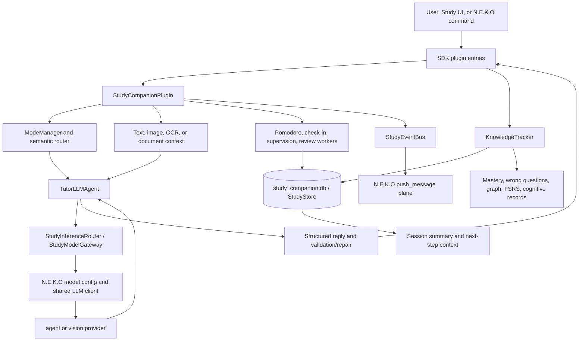

# N.E.K.O Study Companion: source and release audit

**Audit date:** 2026-10-07  
**Scope:** static source, Git history, manifests, official release metadata, and the v0.3.0 packaged plugin. No N.E.K.O production code was changed. No desktop, microphone, speaker, Live2D, or Windows runtime validation was attempted.

## Findings at a glance

Study Companion is a real, substantial learning plugin. It implements a complete user-triggered tutoring loop: mode selection, semantic routing, concept explanation, question generation and checking, answer evaluation, persistent learning records, topic and prerequisite tracking, review scheduling, summaries, documents, OCR/screen input, and study habits. This is considerably more than a marketing-only feature or one prompt attached to the main chat agent.

Most response quality still comes from LLM prompt orchestration. The plugin adds structured response contracts, validators, repair steps, topic binding, deterministic persistence and scheduling, and some rule-based intervention logic. Its ordinary mastery score is a short-window heuristic, and its newer cognitive-evidence engine is narrowly scoped and was disabled in the v0.3.0 artifact. It should be treated as a useful existing product and a source of reusable infrastructure, not as evidence of a validated, general-purpose adaptive tutor.

The key source was easy to miss in the core checkout: the official N.E.K.O core removed the bundled Study Companion directory on 2026-09-03 and now expects the plugin to be installed from the market. The full source is in a separate plugin repository and in its published .neko-plugin release. The v0.3.0 package was downloaded and inspected directly.

## Revisions and evidence examined

| Evidence | Exact revision or identifier | What it establishes |
| --- | --- | --- |
| Official core repository, main at audit snapshot | Project-N-E-K-O/N.E.K.O, commit `c8bf3505e455826ca9a3320e7f7dcace240b73c8` | Current core-side plugin, packaging, and marketplace-only behavior. [Repository](https://github.com/Project-N-E-K-O/N.E.K.O/tree/c8bf3505e455826ca9a3320e7f7dcace240b73c8) |
| Core migration commit | `e27c0f072908ad61ae30c2a58c404203a7edab41` (2026-09-03) | Deleted the old in-tree Study Companion source and changed it to market distribution. [Commit](https://github.com/Project-N-E-K-O/N.E.K.O/commit/e27c0f072908ad61ae30c2a58c404203a7edab41) |
| Separate plugin source repository, main at audit snapshot | MomiJiSan/n.e.k.o_plugin_study_companion, commit `365fcb69c541fcb2ba5ba89981bb536f9bcd1225` (2026-09-21) | Current public source, including changes after the latest package release. [Repository](https://github.com/MomiJiSan/n.e.k.o_plugin_study_companion/tree/365fcb69c541fcb2ba5ba89981bb536f9bcd1225) |
| Latest published plugin release | `v0.3.0`, source commit `1cacbdf801ecc5ff91f03345b585401c5b197a60` (2026-09-13) | Latest package artifact found; this is the release snapshot used for shipped-status judgments. [Release](https://github.com/MomiJiSan/n.e.k.o_plugin_study_companion/releases/tag/v0.3.0) |
| Release build evidence | workflow run `34732528449`; N.E.K.O input commit `b51d4532c59c03b6221bb74560b12e797af9307c`; package SHA-256 `afa45c06ae71c5177e1ab980c8c0d00e9d82b76bad70e75645cba33e2a51857e`; payload hash `4211ffcc7724356aa179839f05c4a7bcb0bb65ab6e32bd3eca8e59f48bf669ee` | Release workflow’s `market-evidence.json` binds source, core revision, and package digest. |

The plugin repository has one public main branch and tags/releases from v0.1.0 through v0.3.0. The official plugin release workflow calls the reusable workflow in Project-N-E-K-O/N.E.K.O, mounts the plugin into the core tree, runs strict market-release checks, builds the package, and uploads it to GitHub Releases. The plugin manifest identifies the author as “N.E.K.O Team.” The current core explicitly lists `study_companion` among plugins that must not ship as a built-in copy because that conflicts with market installation and upgrades.

The latest public plugin source commit is eight days newer than v0.3.0. Do not silently treat every current-main feature or default as released: for example, current main enables cognitive settings by default, but the inspected v0.3.0 package has those settings off. Later current-main work also adds learning-snapshot and knowledge-dungeon boundary behavior.

## Where the source lives

The source-of-truth checkout is the standalone repository [MomiJiSan/n.e.k.o_plugin_study_companion](https://github.com/MomiJiSan/n.e.k.o_plugin_study_companion). It is a flat plugin source layout, with `plugin.toml`, `__init__.py`, `entry_*` modules, tutor and state modules, static UI, tests, and documentation at repository root. The release artifact wraps it as `payload/plugins/study_companion/` and includes the N.E.K.O package manifest and dependency metadata.

The historical bundled source was `plugin/plugins/study_companion/` in the core repository. Commit `e27c0f0729` removes that directory (including `__init__.py`, `tutor_llm_agent.py`, `knowledge_tracker.py`, `study_ocr_pipeline.py`, and the UI) and describes the change as “remove built-in Study Companion plugin; distribute via plugin market.” The current core still has plugin IDs, install handling, package exclusion, and compatibility tests referring to Study Companion. Those references describe integration and migration, not the tutoring implementation.

## Capability matrix

Status refers to the feature as available in the inspected public source and v0.3.0 package. Where current main is newer, that difference is stated explicitly.

| Capability | Status | Implementation evidence and limit |
| --- | --- | --- |
| Plugin lifecycle | **SHIPPED** | `StudyCompanionPlugin` is an SDK plugin with startup/shutdown lifecycle hooks. Startup opens SQLite, loads config and state, initializes the tutor, OCR, tracking, habit and review services, registers UI/entries, and starts optional workers. Shutdown cancels workers and closes services and storage. |
| Study modes | **SHIPPED** | Companion, interactive, and teaching modes are stored and switched by `ModeManager`. The modes chiefly change prompt guidance and transition behavior. |
| Teaching/mode intent classification | **SHIPPED** | Explicit mode phrases are matched by deterministic multilingual keyword rules. A separate semantic-routing LLM classifies subject, task intent, discussion object, and response mode. These are narrow request classifiers, not a general learner-intent model. |
| TutorLLMAgent | **SHIPPED** | Plugin-owned `TutorLLMAgent` provides concept explanation, question generation/validation, answer evaluation, knowledge tracking, session summary, document analysis, and notebook operations. It is instantiated inside the plugin rather than being the main N.E.K.O agent. |
| Concept explanation | **SHIPPED** | Prompts request explanations, prerequisite concepts, a check question, and—when the semantic router identifies an exercise—a solution process and transfer practice. Solution structure can be checked/repaired. Quality is still model-dependent. |
| Question generation | **SHIPPED** | Structured question schema, answer, accepted answers, key points, rubric, solution steps, hint, difficulty, and topic are normalized. Targeted questions have additional contract, topic, difficulty, and quality checks. |
| Answer evaluation | **SHIPPED** | Structured model evaluation yields verdict, score, confidence, feedback, covered/missing points, misconceptions, step feedback, and next action. Normalization and fallback scoring protect shape and storage; they do not guarantee pedagogical correctness. |
| Guided teaching | **SHIPPED** | Teaching mode tells the model to teach step by step and end with a check question. The system instructs actual computations/derivations and solution sections for problems. This is prompt-driven guidance, not a deterministic lesson engine. |
| Follow-up / Socratic interaction | **PARTIAL** | Interactive prompt guidance asks one short follow-up “if it helps”; answer evaluation provides next actions and hints; the adaptive loop can preview another step. There is no general explicit Socratic state machine enforcing question-first instruction over a dialogue. |
| Knowledge tracking | **SHIPPED** | Answer writeback records topic, question, response, evaluation, timing, wrong-question status, mastery snapshot, and review state. Batched transactional write paths and QA-only fallback exist. |
| Knowledge points/concepts | **SHIPPED** | Static topic seeds, subject/stage taxonomies, candidate concepts, mastery records, captured questions, and local retrieval support real topic-level state. |
| Mastery/progress state | **PARTIAL** | Persistent mastery status and answer history are real. The v1 score uses up to ten recent answer scores, consistency, a confidence factor, and difficulty; its recency factor is fixed at 1.0. This is useful progress bookkeeping but not a calibrated probability of durable mastery. A v2 projection exists as a separate path. |
| Knowledge graph | **SHIPPED** | Local graph seeds and edges, prerequisites/blockers, readiness queries, scoped/paginated map payloads, retrieval guidance, and seed lifecycle/audit code are present. |
| FSRS / spaced repetition | **SHIPPED** | Topic and memory cards persist stability, difficulty, reps, lapses, due date, rating, and review logs; due reviews and memory decks are user-facing. The checked-in `fsrs_bridge.py` is a custom deterministic FSRS-like schedule, not a call to an external canonical FSRS implementation. |
| Learning-session persistence | **SHIPPED** | SQLite stores sessions, interaction history, questions/answers/evaluations, topics, mastery, cards, plans, notes, and review records. The plugin persists mode and current tutor state as well. |
| Session summary | **SHIPPED** | Recent interactions and weak points feed a structured summary operation; summary and next actions are saved/exposed. A deterministic fallback exists. |
| OCR / screen context | **SHIPPED** | RapidOCR-based screen capture/selection and submitted images can produce OCR snapshots and classifications. The tutor can fall back to recent OCR text when no text is sent. Background awareness is implemented but disabled by default in v0.3.0. |
| Visual context | **PARTIAL** | Image input can be passed to a separate vision model group and semantic routing; this requires configured vision support. The release defaults `llm_vision_enabled=false`, and passive screen awareness is off. |
| Study material / document context | **SHIPPED** | TXT, Markdown, PDF, and DOCX handling, chunking, document analysis, cancellation/progress, scanned-page OCR, and material-to-topic planning paths are present. Raw original documents are not retained in the learning database by default. |
| Pomodoro | **SHIPPED** | Timer supports focus/break/pause/resume/skip and completed-focus progress linking to goals/check-ins. |
| Supervision | **SHIPPED** | Focus reminders, inactivity/away state, and OS activity signals can drive low-frequency supervision. Settings include enable/disable behavior and reminder intervals. |
| Check-in / habit tracking | **SHIPPED** | SQLite-backed goals, streak/check-in state, makeup windows, and habit-to-session/memory links are implemented. |
| Proactive study behavior | **PARTIAL** | Due-review, session, solution, and Pomodoro events can be pushed into N.E.K.O’s message plane with throttling/cooldowns. Awareness/push is opt-in, plugin auto-start is false, and communication is an event/reminder layer rather than an autonomous study planner. |
| Review / reinforcement | **SHIPPED** | FSRS queues, wrong-question retry, memory decks, ratings, hints, and review completion events provide a genuine repetition/reinforcement workflow. |
| User modelling / learner state | **PARTIAL** | There is per-topic attempt/mastery state, wrong-answer evidence, response-time/hint capture, study settings, habits, and (in current main) a cognitive-evidence model. It is not a broad learner profile with validated interests, strategy preferences, or general subject competence. |
| Cognitive evidence / personalization engine | **EXPERIMENTAL** | A versioned evidence/retention/strategy pipeline, shadow observability, user controls, and acceptance gates exist. The v0.3.0 package defaults its projection/read/intent/retention/personalization features off and limits supported topics to chain-rule cases. Current main turns several gates on, but this post-release source is not the inspected package. |
| Tesseract OCR fallback | **HISTORICAL / REMOVED** | Core history shows Tesseract retired on 2026-09-02 and its plugin module/tests removed. Current plugin release uses RapidOCR and provides availability/fallback notices; compatibility fields remain for migration. |
| Local LLM runtime | **EXPERIMENTAL** | A local model manager/runtime package exists, but release config disables it and the README describes local LLM support as still in development. Production tutor calls use N.E.K.O-managed model configuration. |

## Runtime architecture

### Request and context path

1. The SDK exposes plugin entries such as `study_explain_text`, question generation/evaluation, mode setting, OCR actions, summaries, and knowledge queries. UI actions, explicit N.E.K.O commands, or the host’s plugin-entry dispatch invoke these methods.
2. `study_explain_text` first checks for a deterministic explicit mode switch. It then uses provided text/image, or recent OCR text if available. Tutor context support may call the semantic router through the same tutor agent to infer the subject, concept retrieval terms, and response mode (problem solving, explanation, discussion, or unknown).
3. The plugin assembles operation-specific prompt messages. `TutorLLMAgent` calls a plugin-owned `StudyInferenceRouter` and `StudyModelGateway`, which read the shared N.E.K.O `agent` or `vision` model configuration and invoke the host LLM client or the native Qwen transport. The plugin does not call the main chat agent to tutor; it calls the configured model directly through N.E.K.O’s provider infrastructure.
4. Structured operations parse JSON, normalize the fields, attempt correction on malformed output, and return a `TutorReply`. Model/provider failures return localized fallback responses. The ordinary tutoring API returns the completed response; source uses `ainvoke`, not token-level `astream`. Document jobs may report progress separately, and completed tutoring actions can emit message-plane events.
5. Answer entries call `KnowledgeTracker.on_answer`. It classifies/upserts the topic, records the evaluation and session, updates mastery, wrong-question state, FSRS, and gated cognitive evidence. The persistent store is normally `data/study_companion.db`; the optional knowledge-dungeon bridge has a separate database and read/projection boundary.
6. `StudyEventBus` maps event types to `push_message` visibility/behavior, throttles duplicate and respond events, and forwards notifications through the host message plane. Awareness uses `push_message` directly, but the v0.3.0 awareness default is disabled.

### How context enters

Manual text, selected/captured screen regions, image paste, OCR output, and imported documents all enter through plugin entries/UI. Screen classification uses window title and/or OCR. An optional background awareness loop samples a lightweight screen context, aggregates a rolling window, handles private/idle state, and can push a compact context summary to the main agent at a bounded interval. It is opt-in. Image reasoning is routed to the configured vision model group; release vision and local-model feature flags are off by default.

### How responses return

Tutor output is returned as a finished plugin-entry result to the UI/host. The plugin may separately emit solution-completed, answer-evaluated, review-due, summary, or Pomodoro events into N.E.K.O’s message plane. This is event integration, not streaming tutor tokens into the main agent loop. The plugin’s tutor agent and the main N.E.K.O agent share provider configuration and host messaging, but have separate runtime orchestration.

## Evolution from core history to the market package

The history below is from the official core’s path-filtered Git log plus the standalone plugin’s tags and commits. The core path contains 45 Study Companion-related commits before/through the move; that is enough to trace the dated feature phases, while the standalone repository has 379 commits across four API pages from 2026-08-13 to 2026-09-21.

| Date and revision | Change |
| --- | --- |
| 2026-05-11, core `293e23af48` | Phase 1 added the initial Study Companion plugin, tutor agent, prompt templates, UI, OCR pipeline, state, and store. |
| 2026-05-12, core `104b8ceab9` | Phase 2 added companion/interactive/teaching modes, mode persistence, and explicit mode-intent matching. |
| 2026-05-12, core `4e739ee66c` | Phase 3 added structured teaching responses and screen/scenario classification. |
| 2026-05-13, core `396de3e42b` | Phase 4 added topic knowledge tracking, quality candidates, mastery/FSRS bridge, and initial knowledge graph seed. |
| 2026-05-15 and 2026-05-23, core `b15d9a6097`, `c062ae0c19`, `ac8aa7f198` | UI/export, learning habits/check-ins, Pomodoro, supervision, memory-card workflows, and spaced review were added. |
| 2026-06-01, core `d3d3f3c81d` and `7e8657ea99` | Environment-awareness loop and N.E.K.O command bridge appeared. Later `9c88a1c05b` wired communication events into the host. |
| 2026-06-12, core `5b23f2fe87` | Text-box image paste and visual input were added. June 18 `bd5f06d7d9` strengthened image-question solving. |
| 2026-07-10 through 2026-07-14, core `661d04c4c2`, `bc22a0a3f8`, `5bcebb8216`, `4e0edd669b` | Knowledge graph indexes, validation, math and cross-subject seeds, filters, and relations expanded. |
| 2026-08-13 onward, standalone plugin repository | Separate plugin repository opened and then synced from the upstream bundled source; v0.1.x releases began Aug 14. The repository then added release workflows, tests, and plugin-specific refactors. |
| 2026-08-19, core `3d1de1a04c` | Broad stability/UI/communication and plugin-host integration improvements. |
| 2026-08-20, core `5776b30064` | Added a user-visible OCR fallback notice. This is fallback UX, not a second durable OCR backend. |
| 2026-08-25 through 2026-09-03, standalone commits | Added/strengthened adaptive question planning, mastery projections, graph query contracts, deterministic assessment routing, typed tutor contracts, scanned-PDF OCR, and cognitive evidence/retention. v0.2.0–v0.2.6 releases were published Aug 27–Sep 4. |
| 2026-09-02, core `9a72f45f5f` | Removed bundled Tesseract support; RapidOCR became the supported Study Companion OCR path. |
| 2026-09-03, core `e27c0f0729` | Deleted the in-tree Study Companion source and switched it to market distribution. The current core release checker excludes this plugin from its built-in package list to avoid a conflicting read-only copy. |
| 2026-09-13, plugin source `1cacbdf...`, release v0.3.0 | Published the latest package found. Its release evidence reports upstream market-release checks and tests passed. Cognitive V2 defaults are still off in this artifact. |
| 2026-09-13 through 2026-09-21, plugin commits `a7619f29`, `e5b99b74`, `a846dbce`, merge `365fcb69` | Main advanced the cognitive defaults after the release, added knowledge-dungeon runtime boundaries, and froze review-due/wrong-question counts for snapshot projection. These changes are present on source main but not in the inspected v0.3.0 package. |

### OCR fallback and migration detail

Earlier bundled code had Tesseract as an installable option. The August 20 change adds a clearer fallback notice, then September 2 removes the Tesseract installer/backend and tests, and September 3 moves the plugin out of core. The checked release uses RapidOCR for local OCR and provides dependency-status/fallback UX. Legacy Tesseract config/install references in core are compatibility or migration handling; they do not mean that the released plugin still runs Tesseract as a fallback.

## Quality and maturity assessment

### How much pedagogy is real?

There is real pedagogical workflow: learners can request an explanation, receive a generated exercise, answer it, get a structured evaluation and next action, have weak answers logged for retry, and review material later. Teaching style is mode-sensitive; prompts specify prerequisites, steps, hints, check questions, and transfer practice. Topic scope and prerequisites can influence which question comes next. That is a meaningful tutor loop.

The lesson/explanation voice and most question content are still generated by the configured LLM. Answer verdicts and misconception descriptions also depend on the model unless a deterministic fallback is used. The application wraps that output with JSON/schema normalization, canonical-answer and topic contracts, question validators, bounded retries, deterministic persistence, and local scheduling. This is stronger than prompt-only glue, but it is not a formal curriculum engine or guarantee of correct explanation/assessment.

Interactive mode is a prompt preference, not a robust Socratic tutor policy. Mastery V1 is a reasonable progress indicator but a weak estimate of durable skill: it averages recent score/verdict values, uses fixed recency, and gets much of its input from LLM evaluation. Newer v2 and cognitive paths are better instrumented and evidence-oriented, but in the released package the cognitive feature gates default off and supported cognitive topics are narrow. The package README’s richer roadmap language should not be confused with those runtime defaults.

### Persistence and deterministic versus LLM-driven work

| Mostly deterministic/local | Primarily LLM-driven |
| --- | --- |
| Session/interaction/question/evaluation storage; topic and edge persistence; due-date calculations; check-in and timer transitions; mode keyword matching; screen title/OCR classification; many schema, topic, difficulty, answer provenance, and release-contract checks. | Semantic response routing; concept explanation; question content generation; answer quality judgment/feedback; knowledge-track narrative; session summaries; long-document synthesis; image reasoning. |

Persistence is extensive and genuinely local: SQLite stores interactions, sessions, Q&A, mastery, graph projections, cards, wrong questions, plans, and notes. It is possible to export study data. Source documentation says uploaded originals are not retained by default and sends only task-required text/images to the configured model provider. Persistence should not be mistaken for a rich or validated learner model.

### Maintenance and release quality

The code evolved quickly from May to September, with a concentrated plugin-repository history (379 commits, multiple tagged releases and CI checks). The source main snapshot is from Sep 21; the latest published package is v0.3.0 from Sep 13. This is active recent engineering but also a release/source gap, and no later tag was found by this audit date.

The v0.3.0 market-release check artifact reports `[OK]`, tests passed, and package payload-hash verification succeeded. It also reports eight duplicate plugin-entry ID warnings for disabled/experimental local-model entries. Static inspection of the downloaded release package found a packaging hygiene issue: the compressed artifact is 13,723,920 bytes, but its plugin payload expands to about 253,663,689 bytes (~242 MiB); 637 files and about 220 MiB are under `.pytest-tmp`, alongside Python bytecode. These look like generated test leftovers, not shipped product functionality. This does not erase the source evidence, but it raises distribution size and cleanliness concerns.

## Reuse estimates

These are qualitative estimates of how much of a comparable LiveTutor capability area already has working foundations—not percentages of code or a recommendation about its base repository.

| Area | Coverage estimate | Rationale |
| --- | ---: | --- |
| Teaching infrastructure | **80%** | Tutor request entries, model routing, structured prompts/results, question generation/evaluation, explanation, context assembly, validation, fallback, and summary already exist. A stronger controlled dialogue and curriculum policy would remain. |
| Learning-state coverage | **65%** | Durable sessions, attempts, concepts, graph/prerequisites, mastery, wrong answers, FSRS and memory decks are implemented. Calibrated mastery, broader learner profile, longitudinal outcome evaluation, and portable state boundaries remain. |
| Study workflow coverage | **80%** | Documents/materials, learning workspace, notes, goals, check-ins, timer, supervision, memory/review loops, and summaries exist. A more autonomous but user-steered planning workflow and polished cross-course routines remain. |
| Screen/context integration coverage | **65%** | Screen capture, OCR, pasted images, title/OCR classification, document page OCR, and optional context push exist. Background awareness and vision are opt-in/disabled by release defaults; persistent multi-source context and robust live context UX remain. |

## ALREADY BUILT — DO NOT REBUILD

LiveTutor should first reuse or adapt these existing designs and contracts:

- A plugin lifecycle with explicit startup/shutdown, persistent state, dependency status, cancellation, and worker cleanup.
- A tutor operation boundary with model-group selection, deadlines, quotas, normalized structured outputs, JSON repair, diagnostic fallbacks, and vision handling.
- The question/exercise lifecycle: generation schema, topic/difficulty binding, validation, canonical answer provenance, answer evaluation, retry state, and answer-write transaction.
- Per-topic learning data: graph/seed lifecycle, prerequisites and blockers, answer evidence, mastery snapshots, captured questions, weak-topic retrieval, FSRS-like review schedule, and memory decks.
- Material and context ingestion: text, image, screen OCR, scanned PDF page OCR, document chunking/analysis, and source-aware context boundaries.
- Study habit services: Pomodoro, goals, check-ins, inactivity supervision, event throttling, and session recap.
- Plugin-to-host boundaries: plugin entries/actions, UI bridge, and host `push_message` events for review/timer/tutor completions.
- The testable separation between deterministic state/selection/storage and LLM-generated tutoring content.

Treat the existing implementations as components to assess/adapt, not as proof that each policy is pedagogically correct. In particular, retain the distinction between the released feature set and post-release main-branch additions.

## STILL MISSING

- A robust multi-turn Socratic controller that tracks learner reasoning, asks one targeted question at a time, decides when to hint or reveal, and verifies recovery.
- A broad curriculum/skill model with defensible prerequisites and validated topic coverage across subjects; present seeds and semantic routing are useful but bounded.
- Calibrated and independently evaluated mastery estimates. Current V1 scores are heuristics, and V2/cognitive methods have narrow scope and release gating.
- Proven question/answer quality measurements against learner outcomes, educator review, and broad real-session evidence. Passing structural tests checks contracts, not learning efficacy.
- A released cognitive engine with defaults and supported coverage matching current source claims; current main is newer than the released artifact.
- Fully proactive, learner-controlled planning that accounts for calendar/course deadlines, goals, available study time, and prior learning without requiring manual starts.
- Default-ready live screen/vision workflow with explicit permission states, strong continuity across app/document/chat contexts, and production UX. The present awareness implementation is optional and release defaults disable it.
- Release packaging cleanup: exclude `.pytest-tmp` and `__pycache__`, resolve duplicate entry IDs, and publish a newer release so the artifact catches up with source main.

## Unresolved uncertainties and boundaries

1. **Live market listing:** the public source, generated market-release workflow, release artifact, market evidence, and core marketplace-only integration were verified. This audit did not query the running market catalog or prove current listing visibility, ranking, or install availability.
2. **Post-v0.3.0 behavior:** current plugin main contains newer code but no later release tag/package was found. Treat that work as source-main evidence only until a newer artifact is published and inspected.
3. **Runtime efficacy:** source and release CI were examined, but no N.E.K.O process or end-user session was run. Model quality depends on the user’s configured provider/model and prompts.
4. **Mastery validity:** algorithms and evidence writeback were inspected, but no independent learner dataset or calibration report was found to establish mastery accuracy.
5. **Market test interpretation:** the release artifact says tests passed. The audit did not rerun tests, as requested for this source/release research task.

## Primary evidence links

- [Official N.E.K.O core at inspected revision](https://github.com/Project-N-E-K-O/N.E.K.O/tree/c8bf3505e455826ca9a3320e7f7dcace240b73c8)
- [Core deletion / marketplace migration commit](https://github.com/Project-N-E-K-O/N.E.K.O/commit/e27c0f0729)
- [Official core history for Study Companion path](https://github.com/Project-N-E-K-O/N.E.K.O/commits/main/plugin/plugins/study_companion)
- [Plugin repository at inspected main revision](https://github.com/MomiJiSan/n.e.k.o_plugin_study_companion/tree/365fcb69c541fcb2ba5ba89981bb536f9bcd1225)
- [Plugin v0.3.0 release and package assets](https://github.com/MomiJiSan/n.e.k.o_plugin_study_companion/releases/tag/v0.3.0)
- [Plugin release workflow](https://github.com/MomiJiSan/n.e.k.o_plugin_study_companion/blob/471749a684d7fa9839c4fbf377a8cfc9465e8e30/.github/workflows/release.yml)
- [Core reusable market-release workflow](https://github.com/Project-N-E-K-O/N.E.K.O/blob/c8bf3505e455826ca9a3320e7f7dcace240b73c8/.github/workflows/plugin-market-release.yml)
- [Core release checker and package builder](https://github.com/Project-N-E-K-O/N.E.K.O/blob/c8bf3505e455826ca9a3320e7f7dcace240b73c8/plugin/neko_plugin_cli/commands/release_cmd.py)
- [Core rule excluding marketplace-only plugins from built-in desktop bundles](https://github.com/Project-N-E-K-O/N.E.K.O/blob/c8bf3505e455826ca9a3320e7f7dcace240b73c8/scripts/check_nuitka_dist.py)
- [Core install registry and Study Companion compatibility registration](https://github.com/Project-N-E-K-O/N.E.K.O/blob/c8bf3505e455826ca9a3320e7f7dcace240b73c8/plugin/server/install_registry.py)
- [Plugin manifest](https://github.com/MomiJiSan/n.e.k.o_plugin_study_companion/blob/1cacbdf801ecc5ff91f03345b585401c5b197a60/plugin.toml)
- [Plugin runtime entry point](https://github.com/MomiJiSan/n.e.k.o_plugin_study_companion/blob/1cacbdf801ecc5ff91f03345b585401c5b197a60/__init__.py)
- [Mode manager](https://github.com/MomiJiSan/n.e.k.o_plugin_study_companion/blob/1cacbdf801ecc5ff91f03345b585401c5b197a60/mode_manager.py)
- [Semantic study-input router](https://github.com/MomiJiSan/n.e.k.o_plugin_study_companion/blob/1cacbdf801ecc5ff91f03345b585401c5b197a60/_semantic_routing.py)
- [Tutoring explanation entry](https://github.com/MomiJiSan/n.e.k.o_plugin_study_companion/blob/1cacbdf801ecc5ff91f03345b585401c5b197a60/entry_tutor_explain_entries.py)
- [Structured tutoring prompts](https://github.com/MomiJiSan/n.e.k.o_plugin_study_companion/blob/1cacbdf801ecc5ff91f03345b585401c5b197a60/prompt_templates.py)
- [Tutor agent](https://github.com/MomiJiSan/n.e.k.o_plugin_study_companion/blob/1cacbdf801ecc5ff91f03345b585401c5b197a60/tutor_llm_agent.py)
- [Model/provider gateway](https://github.com/MomiJiSan/n.e.k.o_plugin_study_companion/blob/1cacbdf801ecc5ff91f03345b585401c5b197a60/study_model_gateway.py)
- [Persistent store and schema](https://github.com/MomiJiSan/n.e.k.o_plugin_study_companion/blob/1cacbdf801ecc5ff91f03345b585401c5b197a60/store.py)
- [SQLite schema](https://github.com/MomiJiSan/n.e.k.o_plugin_study_companion/blob/1cacbdf801ecc5ff91f03345b585401c5b197a60/store_schema.py)
- [Knowledge tracking](https://github.com/MomiJiSan/n.e.k.o_plugin_study_companion/blob/1cacbdf801ecc5ff91f03345b585401c5b197a60/knowledge_tracker.py)
- [Deterministic FSRS bridge](https://github.com/MomiJiSan/n.e.k.o_plugin_study_companion/blob/1cacbdf801ecc5ff91f03345b585401c5b197a60/fsrs_bridge.py)
- [Pomodoro timer](https://github.com/MomiJiSan/n.e.k.o_plugin_study_companion/blob/1cacbdf801ecc5ff91f03345b585401c5b197a60/pomodoro_timer.py)
- [Focus supervision controller](https://github.com/MomiJiSan/n.e.k.o_plugin_study_companion/blob/1cacbdf801ecc5ff91f03345b585401c5b197a60/supervision.py)
- [OCR pipeline](https://github.com/MomiJiSan/n.e.k.o_plugin_study_companion/blob/1cacbdf801ecc5ff91f03345b585401c5b197a60/study_ocr_pipeline.py)
