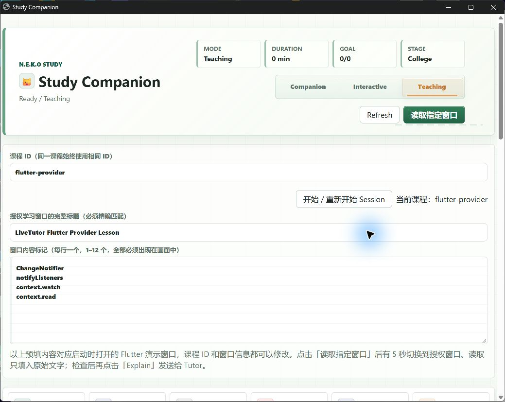

# LiveTutor v0.2：明早交接

**已交付可直接体验的文字 Tutor。** 本机隔离 N.E.K.O 源码宿主、原生 Study UI、明确指定窗口 OCR、DeepSeek 连续教学、选择题/评分/总结和跨 Session 同课记忆已实际运行。没有修改正式安装、私人浏览器或真实学习数据库。

## 最简单的体验方式

1. 双击项目根目录 [Start-Tutor.cmd](../Start-Tutor.cmd)。自动打开专用 Tutor 窗口和 Flutter 代码演示窗口，等待 **Ready / Teaching**。
2. 保持课程 ID `flutter-provider`，点击「开始 / 重新开始 Session」。课程 ID 相同才会找回该课历史。
3. 点击「读取指定窗口」，在 5 秒内切到 **LiveTutor Flutter Provider Lesson**。回到 Tutor 检查 OCR 原始文字，再加上自己的问题并点 **Explain**。读取本身不发送模型请求；目标不匹配时拒绝，不回退全屏。
4. 追问可勾选 **Use previous explanation**；「根据输入内容出题」生成练习，答题后点 **Evaluate Answer**，展开学习面板可 **Summarize Session**。用完在启动控制台按 **Enter**，关闭本次专用窗口及宿主。

明早可以直接问：“我上次哪道题答错了？先用三句话解释 read 和 watch，再给我一题。”也可以更改完整窗口标题与画面标记，读取自己明确授权的学习窗口。代码标点的精确判断优先粘贴源码：本次 OCR 确实漏掉了部分大括号并产生全角括号。

默认每次启动最长 4 小时、最多 30 次模型请求，语义路由也计入预算；一次 Explain 通常消耗 2 次。达到预算后关闭再启动。学习数据库保留在本项目 `benchmarks/raw/neko-product-data`，本次演示课历史也保留；想从零学习可用新的课程 ID。

## 实际验收结果

| 能力 | 结果与证据 |
|---|---|
| 启动/UI | **PASS**：修复静态页面先于插件启动的竞态后，真实双击入口自动 Ready，无手动 Refresh；College 阶段跨重启保留。 |
| 指定窗口 | **PASS**：独立 Flutter 窗口进入原始输入框；不存在的指定标题被拒绝，API 计数不增加。最终专用桌面窗口也捕获成功。[画面](evidence/tutor-desktop-authorized-capture.png)、[原始文字](evidence/tutor-desktop-capture.txt)。 |
| 连续教学 | **完成 15 个代表性学习回合**：逐行解释、read/watch/重建、听不懂换类比、反例、final/const 临时换题再返回、省略指代、四选一、错答纠错、正确评分及总结；另有发现问题后的针对性复验。全为真实 DeepSeek 回复。 |
| 评分/总结 | **PASS**：最终同一 Session 两题分别 wrong/0、correct/100；总结与这两条原始记录一致。中途修复重载创建了多个 Session，最后总结没有冒充整场课程总结。 |
| 重启/课程隔离 | **PASS**：真实关闭宿主再启动，找回全部 3 条评分记录（两错一对）；数学课交集 `{2}` 且没有历史错题；返回 Flutter 后原记录完整。 |
| 学习追踪 | **PARTIAL**：QA、Mastery、FSRS 均落库；自动题目标签有轻微变化，同考点被拆为 3 个 topic，旧错题主题的 mastery 未合并更新。Tutor 最终能依据真实答题准确解释进步，不宣称整个概念已掌握。 |
| 偏好 | 项目专用 Chrome 的学习阶段/模式可保存；同课历史可保留初学者/类比请求。没有验证自动提取并跨课程共享自由文本教学偏好的完整链路。 |
| 延迟 | 16 次讲解服务链路（语义路由开始至讲解完成）中位数 **4.265 秒**，范围 **2.815–8.887 秒**；出题约 3.077 秒、评分约 2.414 秒。不是浏览器端到端延迟。[元数据](evidence/product-api-timing-summary.json)。 |
| 音频与清理 | 文字模式源代码阻断普通 TTS、Realtime 连接及最终音频帧；8 个方法回归通过，实际运行无声音/麦克风测试。最终宿主、专用 Chrome、演示窗口已关闭，4 个项目端口关闭。[清理证据](evidence/tutor-runtime-cleanup.json)。 |

**教学质量可用，但不把模型输出当作始终正确。** 早期真实回复错误建议在 Dart 构造函数前后补类括号，且一度错误解释按钮回调中的 watch。用真实 Flutter/Provider 测试核对后，修复通用纠错/源码依据要求；最终回复明确撤回错误括号建议，正确说明无需修改。简短回答明显改善，但学习记忆回答仍可能多附一句检查题。

完整记录保留了失败和修复前后回复：[真实 Transcript](evidence/flutter-product-transcript.md)（[JSON](evidence/flutter-product-transcript.json)）；[独立教学质量审查](neko-flutter-independent-review-2026-10-10.md)；[记忆验收](neko-product-memory-2026-10-10.md)。实际 Flutter 项目锁定 Provider 6.1.5+1，两项 Widget 测试通过，分别验证正常 read 按钮与回调中 watch 的真实限制。

## 今晚修复的主要问题

- 捕获入口改为精确标题及所有标记检查，只填原始文字，Explain 由用户单独触发。
- 课程历史查询、主题身份、错题、FSRS 及教学上下文按课程限定；换课清空上课的临时输入/题目。
- 原生手动出题缺少 question/attempt ID，导致不能评分；现复用已有题目身份与私有答案处理。
- 出题上下文截断丢掉当前材料，四选一有时没选项；现保留当前材料并要求题干包含完整选项。
- 宽泛“状态/依赖”关键词误匹配排序/拓扑知识图；改用具体主题匹配，未可信命中时自然解释。
- 总结历史次序及末尾评分丢失、重载后 API 预算重置、UI 缓存与启动竞态均已局部修复。
- 首次源码启动观察到额外 DeepSeek Agent 连通性探测，已在调用前禁用。随后 3 次验收启动共 **42/42** 个 Study 请求正常完成（预算 30+8+4）；启动探测单独记录，不隐瞒为零调用。

出口代理只允许授权 DeepSeek，社区地址被拒绝；全程采样未观察到宿主直接外连。采样会漏掉短连接，不能等同于系统网络隔离。未修改 Windows 安全配置。音频功能保持关闭，P2 语音交付跳过；已有完整文字学习能力。

## Git 与下一步

本轮创建范围明确的本地提交，主题 **Deliver isolated LiveTutor v0.2 desktop tutor and real Flutter acceptance**；实际提交号见本次聊天最终回复或 `git log -1`。没有 Push。开始时已有的 `.workbuddy/memory/2026-10-09.md` 与 `.workbuddy/memory/MEMORY.md` 改动保留，未纳入提交。

运行依赖、官方源码快照、凭据、专用浏览器 profile 与隔离数据库均在本机 ignored 环境，Git 保存产品 overlay、启动器和可复核证据；仅克隆提交不能自动恢复整个运行环境。[上游复用说明](neko-upstream-adoption-2026-10-10.md)。

你下一步只需双击启动入口，体验读一次代码、连续追问两次和做一道题，重点判断讲解是否符合自己的学习节奏。后续最有价值的局部改进是复用稳定 topic ID 更新同概念 Mastery，而非新建记忆框架。
